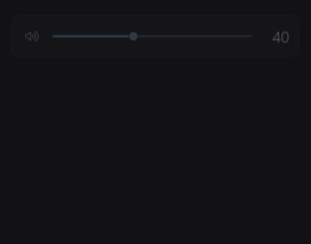
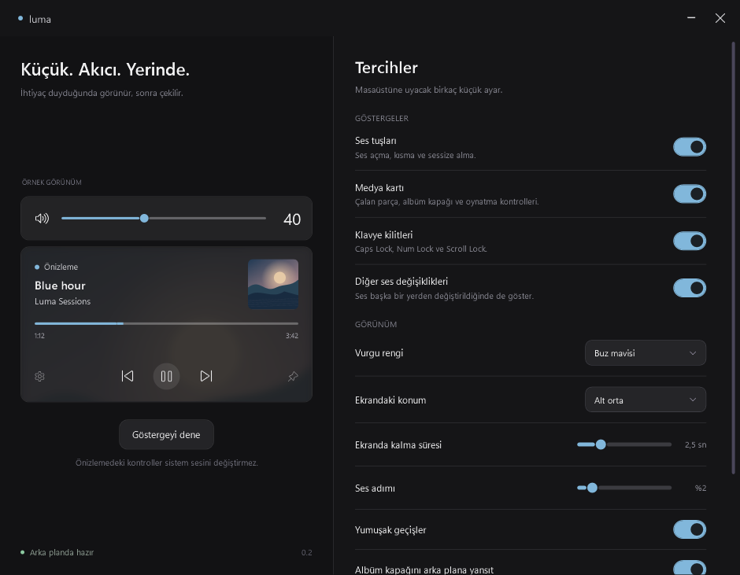

# Luma

Windows 11 için sade ve akıcı ses, medya ve klavye göstergeleri. İnce bir ses şeridi, ayrı bir medya kartı ve ihtiyacın bittiğinde kaybolan küçük kontroller.

**[Windows için indir](https://github.com/kyrerdm/Luma/releases/latest)** · [Kurulum](#kurulum) · [Özellikler](#özellikler) · [Kaynak koddan derleme](#kaynak-koddan-derleme)



*Görseldeki parça ve kapak, uygulamanın kendi önizlemesidir.*

## Kurulum

**Gereksinim:** Windows 11, 64 bit (x64). ARM64 için ayrı paket henüz yoktur.

1. **[Son sürüm sayfasını aç](https://github.com/kyrerdm/Luma/releases/latest).**
2. Sayfanın **Assets** bölümünden **`Luma-0.2.0-win-x64.zip`** dosyasını indir. GitHub'ın eklediği **Source code** dosyaları çalıştırılabilir uygulamayı içermez.
3. İndirilen ZIP'e sağ tıkla ve **Tümünü ayıkla** seçeneğiyle kalıcı bir klasöre çıkar. Örneğin `C:\Users\kullanıcı\Apps\Luma`.
4. Çıkardığın klasördeki **`Luma.exe`** dosyasını aç.
5. Klavyeden sesi açıp kısarak göstergeyi dene. Ayarlar ekranından **Göstergeyi dene** düğmesini de kullanabilirsin.

Paket, gereken .NET Desktop Runtime dosyalarını içerir. **Ayrıca .NET veya Visual Studio yüklemek gerekmez.** Bu sürüm taşınabilirdir; bir kurulum sihirbazı ya da MSI paketi içermez. Dosyaları ZIP'in içinden çalıştırmak yerine önce klasöre çıkar.

### Her oturumda otomatik başlatma

Ayarlar ekranında **Windows ile başlat** seçeneğini aç. Luma sonraki oturumlarda sistem tepsisinde hazır olur. Bu ayarı açtıktan sonra uygulama klasörünü taşımadan önce seçeneği kapat; yeni konumdan açtıktan sonra tekrar etkinleştir.

### Güncelleme

1. Eski Luma'nın **sistem tepsisi simgesine sağ tıkla → Çıkış** seç. Pencereyi kapatmak uygulamadan çıkmaz.
2. Yeni ZIP'i ayrı bir klasöre çıkar ve yeni **`Luma.exe`** dosyasını aç.
3. **Windows ile başlat** daha önce açıksa, yeni sürümde kapatıp tekrar açarak başlangıç yolunu güncelle.

Mevcut tercihler korunur; ayarlar `%LOCALAPPDATA%\LumaFlyouts\settings.json` dosyasında saklanır.

### Kaldırma

**Windows ile başlat** seçeneğini kapat, tepsiden **Çıkış** seç ve Luma'yı çıkardığın klasörü sil. Tercihlerini de kaldırmak istersen `%LOCALAPPDATA%\LumaFlyouts` klasörünü silebilirsin.

## Özellikler

| Özellik | Açıklama |
| --- | --- |
| İnce ses şeridi | Ses açma, kısma, sessize alma, kaydırıcı ve fare tekerleğiyle kontrol. |
| Ayrı medya kartı | Windows'a medya oturumu sunan oynatıcılardan parça, sanatçı ve kapak bilgisi. |
| Oynatma kontrolleri | Oynatıcının desteklediği ölçüde oynat/duraklat, önceki/sonraki ve zaman çizelgesi. |
| Klavye göstergeleri | Caps Lock, Num Lock ve Scroll Lock durumu. |
| Akıcı geçişler | Kartların açılışı, kapanışı, boyut değişimi ve ses kaydırıcısı için hafif animasyonlar. |
| Görünüm tercihleri | Buz mavisi, lila ve adaçayı vurgu renkleri; albüm kapağının bulanık arka plan yansıması. |
| Konum ve süre | Üst/alt orta veya sağ köşeler; ayarlanabilir görünme süresi ve ses adımı. |
| Çoklu ekran | Gösterge fare imlecinin bulunduğu monitörde açılır. |
| Sistem tepsisi | Ayarlara erişim, önizleme ve uygulamadan tamamen çıkma. |

## Kullanım ipuçları

- Ses şeridindeki hoparlör simgesi sesi kapatıp açar. Fare tekerleği, imleç şeridin üzerindeyken ses seviyesini değiştirir.
- İmleci göstergenin üzerine getirince otomatik gizleme durur. Medya kartındaki **pin** simgesi göstergeyi açık tutar; tekrar basınca otomatik gizlemeye döner.
- Göstergeye **sağ tıklayarak** ayarlara ulaşabilir veya göstergeyi gizleyebilirsin.
- Medya oturumu yoksa boş medya kartı gösterilmez. Oynatıcının desteklemediği düğmeler pasif olur.
- **Göstergeyi dene** örnek veri kullanır. Bu moddaki ses, medya ve zaman çizelgesi kontrolleri gerçek sesi veya oynatıcıyı değiştirmez.
- Ayarlar penceresini kapatmak Luma'yı tepsiye gizler. Tamamen kapatmak için tepsi simgesine sağ tıkla ve **Çıkış** seç.

<details>
<summary>Ayarlar ekranı</summary>



</details>

## Mevcut durum ve sınırlamalar

**0.2.0 erken bir sürümdür.** Ses ve klavye göstergeleri ile medya kartının uygulaması hazırdır. Parlaklık kontrolü, açık tema, ARM64 paketi, kurulum sihirbazı ve Microsoft Store yayını henüz yoktur. Paket henüz dijital olarak imzalı değildir.

Medya bilgisi ve düğmeler oynatıcının Windows'a sunduğu özelliklere bağlıdır. Canlı yayınlarda süre veya ileri sarma olmayabilir. Windows medya API'sine erişim ve komut yönlendirmesi kontrol edildi; canlı Spotify/diğer oynatıcılarda uçtan uca kullanım henüz doğrulanmadı.

Standart ses tuşları CoreAudio üzerinden işlenir. Bazı üreticilerin Fn yazılımları veya kumandaları farklı yollar kullanabilir; bunlarda Windows'un kendi paneli de görünebilir. Fiziksel Fn tuşları, yönetici olarak çalışan uygulamalar ve farklı DPI değerlerinde çoklu monitör kullanımı ayrıca denenmelidir.

Bir sorunla karşılaşırsan **[Issues](https://github.com/kyrerdm/Luma/issues)** bölümüne Windows sürümünü, Luma sürümünü, kullandığın oynatıcıyı/donanımı ve sorunu tekrar oluşturma adımlarını ekleyebilirsin.

## Gizlilik ve sistem davranışı

Luma telemetri göndermez, ağ isteği yapmaz ve klavye kaydı tutmaz. Klavye kancası ses ve kilit tuşları için kullanılır. Explorer veya Windows sistem dosyaları değiştirilmez. **Windows ile başlat** açıldığında yalnızca mevcut kullanıcının `HKCU\Software\Microsoft\Windows\CurrentVersion\Run` alanına `LumaFlyouts` girdisi eklenir.

## Kaynak koddan derleme

Son kullanıcıların bu adımlara ihtiyacı yoktur; hazır uygulama **[Releases](https://github.com/kyrerdm/Luma/releases)** bölümündedir.

Geliştirme için **Windows 11**, **Git** ve **.NET 10 SDK x64 (10.0.402 veya daha yeni bir 10.0 SDK)** gerekir. Proje WPF, Win32/CoreAudio ve Microsoft Windows SDK .NET projeksiyonlarını kullanır; harici bir UI kütüphanesi içermez.

```powershell
git clone https://github.com/kyrerdm/Luma.git
cd Luma
.\scripts\build.ps1
.\scripts\verify.ps1
```

Çalışma zamanı dahil taşınabilir paket:

```powershell
.\scripts\build.ps1 -Publish -SelfContained
.\scripts\verify.ps1 -Published
.\scripts\package.ps1
```

Çıktı klasörü `artifacts\Luma-0.2.0`, paylaşılacak dosya `artifacts\Luma-0.2.0-win-x64.zip` konumundadır. SHA-256 özeti ZIP'in yanındaki `.sha256` dosyasına yazılır. Hata ayıklama sembolleri dağıtım ZIP'ine eklenmez.

`build.ps1 -Publish`, çalışma zamanını dahil etmeden paket oluşturur; bu çıktı için .NET 10 Desktop Runtime gerekir. Kişisel ayarlardan ayrı bir geliştirme oturumu için:

```powershell
.\artifacts\Luma-0.2.0\Luma.exe --data-dir .\.local
```

### Doğrulama kapsamı

0.2.0 için **27 kontrol** başarılı oldu. Kontroller; ayarların kurtarılmasını ve kalıcılığını, CoreAudio okumasını, gerçek klavye kancasına yazılımsal ses tuşu basışları gönderilmesini, Windows medya API'sinin açılmasını, WPF pencerelerini ve kullanıcı tercihlerini kapsar. Önizlemenin sistem komutları göndermemesi, animasyonun fazladan ses isteği üretmemesi, zaman çizelgesi ve boş medya kartının kapanması da kontrol edilir.

Testler normal Windows masaüstü erişimi gerektirir; başsız veya kısıtlı bir ortamda giriş testleri çalışmayabilir. Başlangıç kaydı değiştirilmez. Sonuçlar ve WPF'den alınan görseller `artifacts\verification` içine yazılır. Animasyon karelerini GIF'e çevirmek için Pillow bulunan bir Python ile `scripts\render-motion.py` çalıştırılabilir.

## İlham ve üçüncü taraf bileşenler

Luma, [ModernFlyouts](https://github.com/ModernFlyouts-Community/ModernFlyouts) fikrinden ilham alan bağımsız bir projedir. ModernFlyouts'un kodunu veya görsel varlıklarını içermez; onunla bağlantılı resmi bir devam projesi değildir. Örnek albüm kapağı WPF ile çizilmiştir.

Dağıtım paketindeki .NET, Windows Desktop, Windows SDK ve C#/WinRT bildirimleri uygulamanın yanındaki lisans/bilgi dosyalarında bulunur.
