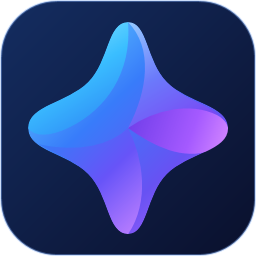
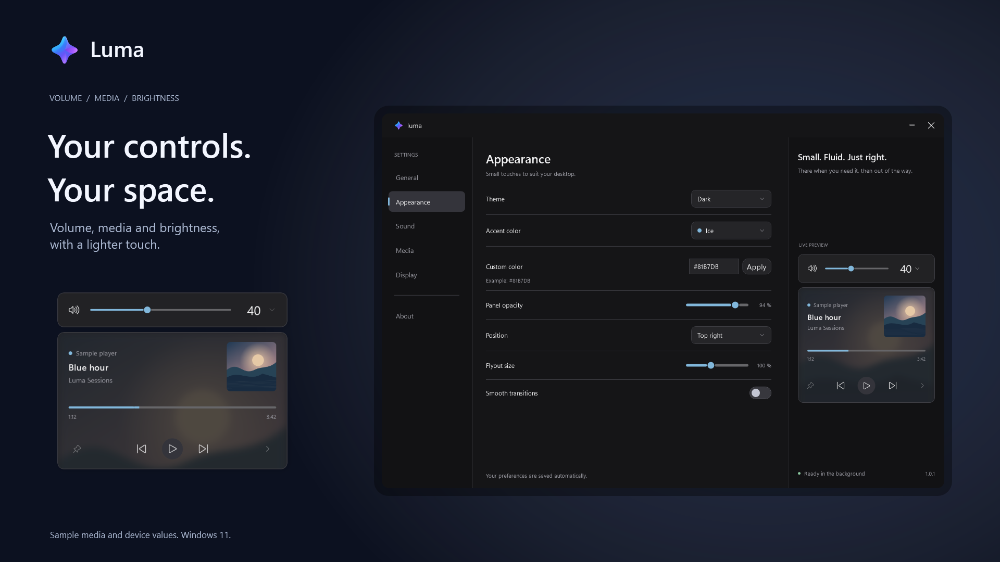

# Luma

Windows 11 için ücretsiz, açık kaynaklı ses, medya ve parlaklık göstergeleri.

**[Windows için indir](https://github.com/kyrerdm/Luma/releases/latest)** · [English](../README.md) · [Diğer diller](QUICKSTART.md)

*Görsellerdeki medya ve aygıt bilgileri örnektir.*

## Özellikler

- Sistem sesi, sessize alma, ses çıkışı seçimi ve uygulama bazında ses kontrolü.
- Oynatıcının desteklediği kapak, oynatma, ilerleme ve medya kaynağı kontrolleri.
- Desteklenen laptop ekranlarında ve isteğe bağlı DDC/CI harici monitörlerde parlaklık kontrolü.
- Geçici Caps Lock, Num Lock ve Scroll Lock göstergeleri.
- Altı konum, ayarlanabilir boyut ve monitör seçimi.
- Açık, koyu ve sistem teması; 12 vurgu rengi ve özel renk seçeneği.
- Canlı önizleme, ayar yedeği ve isteğe bağlı Windows ile başlatma.
- İngilizce, Türkçe, Almanca, İspanyolca ve İtalyanca. Yeni kurulum İngilizce başlar; güncelleme dil tercihini korur.

## Kurulum

**Windows 11 x64** gerekir. .NET çalışma zamanı pakete dahildir.

1. [Son sürümdeki](https://github.com/kyrerdm/Luma/releases/latest) **Assets** bölümünden adı **`-Setup.exe`** ile biten dosyayı indir.
2. Dosyayı açıp **Install → Open Luma** seç. Yönetici yetkisi gerekmez.
3. Başlat menüsünde **Luma** ara. Ayarları açmak için tepsi simgesine bir kez tıkla.

Taşınabilir kullanım için **`-win-x64.zip`** dosyasını indir, kalıcı bir klasöre çıkar ve `Luma.exe` dosyasını aç. **Source code** arşivleri çalıştırılabilir uygulamayı içermez. GitHub paketleri henüz dijital imzalı değildir.

## Kullanım, güncelleme ve kaldırma

Ses tuşuna basınca Luma görünür. Klavyenin standart oynat/duraklat, sonraki, önceki ve durdur tuşları da medya kartı ayarı etkinken ve oynatıcı Windows'a medya oturumu sunuyorsa kartı gösterir; tuşların normal oynatma işlevi devam eder. Ses şeridindeki ok, ses çıkışı ve uygulama sesleri panelini açıp kapatır; panel dışına tıklamak da kapatır. Medya kartındaki kaynak oku Windows'un sunduğu oturumlar arasında geçiş yapar. Pin simgesi ses/medya kartını açık tutar; kilit tuşu bildirimleri geçici kalır.

Ayarları kapatmak uygulamayı tepsiye gizler. Tamamen çıkmak için tepsi simgesine sağ tıklayıp **Çıkış** seç. Türkçe için **General → Language → Türkçe** yolunu kullan. **Windows ile başlat** tercihi Genel bölümündedir.

**Genel → Güncellemeleri denetle** yoluyla veya yeni Setup dosyasıyla güncelle. Farklı bir kurulum ya da taşınabilir sürüm açmadan önce eski kopyadan çık. **Windows Ayarları → Uygulamalar → Yüklü uygulamalar** üzerinden kaldırabilirsin. GitHub sürümünün tercihleri sonraki kullanım için `%LOCALAPPDATA%\LumaFlyouts` klasöründe kalır; içe/dışa aktarma ayarlarda bulunur.

## Uyumluluk

- Parlaklık desteği ekran ve sürücülere bağlıdır. Bazı cihazlarda Windows'un parlaklık göstergesi kısa süre görünebilir.
- Medya desteği oynatıcıya bağlıdır. Tarayıcı sekmeleri aynı Windows medya oturumunu paylaşırsa ayrı ayrı seçilemez.
- Ses karıştırıcı, seçili çıkıştaki oturumları gösterir; aynı uygulamanın oturumları birlikte ayarlanır.
- Ayrı ARM64 paketi yoktur. Farklı donanım, uyku/uyanma ve erişilebilirlik kontrolleri [doğrulama notlarında](KARARLI_SURUM.md) takip edilir.

Günlük kullanım çevrimdışıdır. İstediğinde yapılan GitHub güncelleme denetimi ve indirmeleri internete bağlanır. Yazdığın metinler ve telemetri kaydedilmez; destek raporları yerel olarak saklanır. [Gizlilik politikası](PRIVACY.md).

## Microsoft Store

Store paketleme altyapısı, açıklamalar ve görseller hazırdır. **Uygulama henüz Microsoft Store'da yayımlanmadı.** Gerçek yayıncı kimliği bağlandıktan sonra paketli kurulum ve Windows sertifikasyon kontrolleri tamamlanmalıdır. [Store yayın rehberinden](store/BASLA-BURADAN.md) devam edebilirsin.

## Geliştirme ve lisans

[Derleme ve doğrulama](DEVELOPMENT.md) · [Çeviriler](LOCALIZATION.md) · [Sürüm notları](https://github.com/kyrerdm/Luma/releases) · [Sorun bildir](https://github.com/kyrerdm/Luma/issues)

**kyrerdm** tarafından tasarlanıp geliştirildi. [MIT lisanslıdır](../LICENSE); üçüncü taraf bildirimleri uygulamanın Hakkında bölümünde çevrimdışı okunabilir. ModernFlyouts fikrinden ilham alan bağımsız bir projedir; ModernFlyouts kodu veya görselleri içermez.
