# Luma


Windows 11 için sade ve akıcı ses, parlaklık, medya ve klavye göstergeleri. İnce şeritler, ayrı bir medya kartı ve ihtiyacın bittiğinde kaybolan küçük kontroller.

**English · Türkçe · Deutsch · Español · Italiano** — Yeni kurulum İngilizce başlar; **General → Language → Türkçe** yoluyla değiştirebilirsin. Güncelleme mevcut dil seçimini korur. [Çok dilli başlangıç rehberi](QUICKSTART.md).

**[Windows için indir](https://github.com/kyrerdm/Luma/releases/latest)** · [Kurulum](#kurulum) · [Özellikler](#özellikler) · [Kaynak koddan derleme](#kaynak-koddan-derleme)


*Görsellerdeki parça, kapak ve kaynak bilgileri örnek veridir.*

## Kurulum

**Gereksinim:** Windows 11, 64 bit (x64). ARM64 için ayrı paket henüz yoktur.

**Kurulum paketi:** [Son sürümden](https://github.com/kyrerdm/Luma/releases/latest) **`Luma-1.0.0-Setup.exe`** dosyasını indir, aç ve **Kur → Luma'yı aç** seç. Yönetici yetkisi gerekmez. Başlat menüsü kısayolu ve Windows'un yüklü uygulamalar listesine kaldırma kaydı eklenir. Masaüstü kısayolu isteğe bağlıdır. Dosyalar `%LOCALAPPDATA%\Programs\Luma\1.0.0` klasörüne kurulur. Windows ile otomatik başlatma tercihi ayrıca ayarlardan seçilir.

**Taşınabilir kullanım:**

1. **[Son sürüm sayfasını aç](https://github.com/kyrerdm/Luma/releases/latest).**
2. Sayfanın **Assets** bölümünden **`Luma-1.0.0-win-x64.zip`** dosyasını indir. GitHub'ın eklediği **Source code** dosyaları çalıştırılabilir uygulamayı içermez.
3. İndirilen ZIP'e sağ tıkla ve **Tümünü ayıkla** seçeneğiyle kalıcı bir klasöre çıkar. Örneğin `C:\Users\kullanıcı\Apps\Luma`.
4. Çıkardığın klasördeki **`Luma.exe`** dosyasını aç.
5. Klavyeden sesi açıp kısarak göstergeyi kullan. Ayarları açmak için tepsi simgesine bir kez sol tıkla.

Paket, gereken .NET Desktop Runtime dosyalarını içerir. **Ayrıca .NET veya Visual Studio yüklemek gerekmez.** ZIP taşınabilir kullanım içindir. Kurulum isteyenler ayrı Setup.exe dosyasını kullanabilir; MSI paketi yoktur. Dosyaları ZIP'in içinden çalıştırmak yerine önce klasöre çıkar.

### Her oturumda otomatik başlatma

Ayarlar ekranında **Windows ile başlat** seçeneğini aç. Luma sonraki oturumlarda sistem tepsisinde hazır olur. Bu ayarı açtıktan sonra uygulama klasörünü taşımadan önce seçeneği kapat; yeni konumdan açtıktan sonra tekrar etkinleştir.

### Güncelleme

1. Eski Luma'nın **sistem tepsisi simgesine sağ tıkla → Çıkış** seç. Pencereyi kapatmak uygulamadan çıkmaz.
2. Yeni ZIP'i ayrı bir klasöre çıkar ve yeni **`Luma.exe`** dosyasını aç.
3. **Windows ile başlat** zaten açıksa yeni Luma.exe açıldığında başlangıç yolu güncellenir. Kapalıysa kapalı kalır.

Mevcut tercihler korunur; ayarlar `%LOCALAPPDATA%\LumaFlyouts\settings.json` dosyasında saklanır.

Kurulu sürümde yeni **Setup.exe** dosyasını açıp **Kur → Luma'yı aç** seçebilirsin. 0.7 ve sonrasında **Genel → Güncellemeleri denetle → İndir ve güncelle** yolunu da kullanabilirsin. Paket yalnızca sen istediğinde indirilir; GitHub API'nin verdiği dosya boyutu ve SHA-256 özeti doğrulanır. Eksik veya değişmiş dosya çalıştırılmaz. Yeni sürüm ayrı klasöre kurulur ve açılışı beklenir; açılamazsa doğrulanmış önceki kurulumun kısayolları/başlangıç yolu geri yüklenip önceki sürüm açılır. Önceki sürüm klasörü korunur. İptal veya indirme hatası sırasında mevcut Luma çalışmayı sürdürür. Doğrulanabilir paket bilgisi yoksa sürüm sayfası sunulur; arka planda kendiliğinden denetleme veya indirme yapılmaz.

### Kaldırma

**Windows ile başlat** seçeneğini kapat, tepsiden **Çıkış** seç ve Luma'yı çıkardığın klasörü sil. Tercihlerini de kaldırmak istersen `%LOCALAPPDATA%\LumaFlyouts` klasörünü silebilirsin.

Kurulum paketi kullanıldıysa **Windows Ayarları → Uygulamalar → Yüklü uygulamalar → Luma → Kaldır** yolunu kullan. Kaldırıcı kurulum dosyalarını, kendisine ait kısayolları ve başlangıç kaydını temizler; kişisel tercih dosyasını korur.

## Özellikler

| Özellik | Açıklama |
| --- | --- |
| İnce ses şeridi | Ses açma, kısma, sessize alma, kaydırıcı ve fare tekerleğiyle kontrol. Ok ve açılır panel sağ kenarda hizalanır. |
| Canlı ayarlar önizlemesi | Mevcut ses, sessize alma, seçili medya, kapak ve ilerleme; pencere gizliyken önizleme saati durur. |
| Ses çıkışı seçimi | Ses şeridinin sağındaki okla kulaklık, hoparlör ve diğer etkin çıkışlar arasında geçiş. |
| Uygulama sesleri | Açılır panelde seçili ses çıkışının uygulamalarını ayrı ayarla veya sessize al. |
| Laptop parlaklığı | Desteklenen dahili ekranda Fn/Windows değişikliklerini göster; ayarlardan veya parlaklık şeridinden düzeyi değiştir. |
| Ayrı medya kartı | Windows'a medya oturumu sunan oynatıcılardan parça, sanatçı ve kapak bilgisi. |
| Oynatma kontrolleri | Oynatıcının desteklediği ölçüde oynat/duraklat, önceki/sonraki ve zaman çizelgesi. |
| Medya kaynağı seçimi | Sağ alttaki okla Windows'un sunduğu kaynakları listele; seçilen oynatıcının bilgileri ve düğmeleri birlikte değişir. |
| Klavye göstergeleri | Caps Lock, Num Lock ve Scroll Lock durumu. |
| Akıcı geçişler | Kartların açılışı, kapanışı, boyut değişimi ve ses kaydırıcısı için hafif animasyonlar. |
| Görünüm tercihleri | Renk örnekleriyle 12 vurgu rengi; albüm kapağının bulanık arka plan yansıması. |
| Tema ve özel renk | Açık/koyu/Windows teması, özel RGB rengi ve %65–%100 panel opaklığı. |
| Tam ekran tercihi | Gösterilecek monitörü kaplayan oyun/video penceresinde Luma göstergelerini gizle. |
| Harici ekran parlaklığı | İsteğe bağlı DDC/CI taramasıyla destekleyen bağlı ekranları ayrı ayarla. |
| Kurulum ve güncelleme | Kullanıcı hesabına kurulum, kaldırıcı, doğrulanan indirme ve açılışta başarısız olursa önceki kuruluma dönüş. |
| Düzenli ayarlar | Genel, Görünüm, Ses, Medya, Ekran ve Hakkında; Türkçe ve İngilizce dil seçimi. |
| Hakkında ve lisanslar | Geliştirici imzası, sürüm kopyalama, proje bağlantıları; tam metinli çevrimdışı lisans okuyucu. |
| Klavyeyle gezinme | Ctrl+1–6 bölüm kısayolları, ileri/geri sekme sırası ve görünür odak. |
| Tercih yedekleri | Sürümlü JSON içe/dışa aktarma, onaylı sıfırlama; canlı ses/parlaklık ve Windows başlangıç tercihi korunur. |
| Otomatik ayar kurtarma | Son geçerli yerel yedek, bozuk/eksik dosyadan geri dönüş ve ayarlarda açıklanan kurtarma durumu. |
| Başlangıç ve destek | Yeni kullanıcılar için kısa rehber; isteğe bağlı ve yerel teknik destek raporu. |
| Konum ve süre | Dört köşe ve üst/alt orta; %75–%140 boyut ayarı, görünme süresi ve ses adımı. |
| Çoklu ekran | İmlecin olduğu ekran, ana ekran veya bağlı monitörlerden biri seçilebilir. Seçilen ekran çıkarılırsa ana ekran kullanılır. |
| Sistem tepsisi | Tek sol tıkla ayarlar; sağ tık menüsünde yalnızca ayarlar ve çıkış. |
| Işıltı logosu | Mavi–mor geçişli, yumuşak dört uçlu simge; uygulama dosyası, tepsi ve ayarlar başlığında ortak tasarım. |

## Ayarları yönetme

Ayarlar altı bölüme ayrılır. **Genel** bölümünden dili, Windows başlangıcını, güncellemeleri ve destek araçlarını; **Görünüm** bölümünden tema/renk/konum/boyutu; **Ses**, **Medya** ve **Ekran** bölümlerinden ilgili kontrolleri yönetebilirsin. **Hakkında** bölümünde sürüm, geliştirici ve lisanslar yer alır. `Ctrl+1`–`Ctrl+6` ile bölümlere geçebilir, `Tab` ve `Shift+Tab` ile ilerleyip geri dönebilirsin. Yeni kullanıcılara kısa bir başlangıç rehberi açılır; mevcut kullanıcılar ayarlarına devam eder.

**Genel → Dışa aktar** bir Luma JSON yedeği oluşturur. **İçe aktar** yalnızca desteklenen Luma yedeğini kabul eder; bozuk veya daha yeni dosya biçimleri mevcut tercihleri değiştirmez. Başka bilgisayarda bulunmayan monitör tercihi ana ekrana döner. **Sıfırla** onaydan sonra varsayılanları uygular. Bu işlemler Windows başlangıç tercihini ve canlı ses/parlaklık düzeylerini değiştirmez.

Başarılı kayıtlarda son geçerli dosya aynı klasörde `settings.json.bak` olarak korunur. Ana dosya bozulur veya kaybolursa bu yedeğe dönülür; ayarlarda kurtarma bilgisi görünür. İki dosya da okunamazsa varsayılanlara dönüldüğü açıklanır. Ayarları okumak dosyaları kendiliğinden değiştirmez. Bozuk dosya sağlam yedeğin üzerine döndürülmez.

Geliştirme sırası: [Yol haritası](ROADMAP.md) · [Donanım beta testi](BETA_TEST_PLANI.md) · [Klavye ve dil kontrolü](ERISILEBILIRLIK.md) · [İmza ve Store hazırlığı](DAGITIM.md)

## Kullanım ipuçları

- Ses şeridindeki hoparlör simgesi sesi kapatıp açar. Fare tekerleği, imleç şeridin üzerindeyken ses seviyesini değiştirir.
- Ses şeridinin **sağındaki küçük ok**, ses çıkışı ve uygulama sesleri panelini açar. Panel açıkken otomatik gizleme durur. Çıkış seçimi Windows'un genel ve medya varsayılanını değiştirir; ayrı iletişim/arama aygıtı tercihi korunur. Uygulamaların yeni varsayılana geçmesi kendi ses yönlendirme davranışlarına bağlıdır.
- Uygulama sesleri seçili çıkıştaki Windows ses oturumlarından oluşur. Aynı uygulamanın birden fazla oturumu birlikte ayarlanır. Başka çıkışa özel yönlendirilmiş uygulamalar bu listede görünmez. Medya kaynağı seçimi ayrı bir özelliktir.
- İmleci göstergenin üzerine getirince otomatik gizleme durur. Medya kartının sol altındaki **pin** simgesi göstergeyi açık tutar; tekrar basınca otomatik gizlemeye döner. Kilit tuşu bildirimleri geçicidir; süreleri bitince sabitlenmiş ses/medya kartı geri gelir.
- Göstergeye **sağ tıklayarak** ayarlara ulaşabilir veya göstergeyi gizleyebilirsin.
- Medya oturumu yoksa boş medya kartı gösterilmez. Oynatıcının desteklemediği düğmeler pasif olur.
- Medya kartının **sağ altındaki ok**, kaynak listesini açar. Listede uygulama, parça adı ve çalma durumu görünür. Kaynak değiştirmek diğer oynatıcıları durdurmaz veya başlatmaz.
- Manuel seçimin kaynak duraklatılsa da korunur. Kaynak kapanırsa kalan oturumlara dönülür. Menüdeki **Otomatik** seçeneği çalan kaynağı takip eder; Luma yeniden açıldığında otomatik modla başlar.
  Bu seçim Luma kartındaki medya düğmeleri için geçerlidir.
- **Gösterilecek ekran** alanından monitör seçebilirsin. Seçtiğin ekran bağlı değilken ana ekran kullanılır; yeniden bağlandığında tercih ettiğin ekrana dönülür.
- **Ekran parlaklığı → Dahili ekran** kaydırıcısı desteklenen laptop ekranının parlaklığını değiştirir. Donanımın desteklediği en yakın seviyeye yuvarlanır. Parlaklık şeridinin üzerindeyken fare tekerleği de kullanılabilir.
- **Parlaklık göstergesi** tercihi, Fn tuşları veya Windows üzerinden yapılan değişikliklerde Luma'nın açılmasını kapatır; ayarlardaki kaydırıcı çalışmaya devam eder. Sabitlenmiş ses/medya kartı parlaklık bildirimi bitince geri gelir.
- **Windows parlaklık panelini gizle** varsayılan olarak açıktır. Luma'nın parlaklık göstergesi etkinken altta çıkan ikinci Windows panelini gizler. Bu tercihi veya Parlaklık göstergesi seçeneğini kapatırsan Windows paneline müdahale edilmez.
- Ayarlardaki **Canlı önizleme**, mevcut ses seviyesini/sessize alma durumunu ve Luma'da seçili medya kaynağını gösterir. Parça, sanatçı, kapak, oynatma durumu ve ilerleme süresi değişiklikleri takip edilir. Medya yokken boş durum görünür; ayarlar gizlendiğinde önizleme saati durur. Bu alan izleme içindir; ses veya oynatma komutu göndermez.
- Ayarlar penceresini üst çubuğundan tutarak taşıyabilirsin. Renk, konum ve monitör listeleri koyu tema ve arayüzle aynı yazı tipini kullanır.
- Vurgu renkleri: buz mavisi, lila, adaçayı, gül kurusu, yakut, mercan, şeftali, kehribar, limon, turkuaz, okyanus ve gümüş. Renkler listedeki küçük örneklerle gösterilir.
- **Tema** alanında açık, koyu veya Windows ile aynı görünümü seç. **Özel renk** alanına `#RRGGBB` biçiminde bir kod yazıp **Seç** düğmesine bas. Panel opaklığı yalnızca göstergenin zeminini değiştirir; yazılar saydamlaştırılmaz.
- **Tam ekranda göstergeleri gizle** varsayılan olarak kapalıdır. Açıldığında hedef monitörü kaplayan ön plandaki pencerede bildirimler açılmaz; ses ve parlaklık komutları çalışmaya devam eder. Ekranı tamamen kaplayan bazı kenarlıksız pencereler de tam ekran sayılabilir. Bu tercih normal pencere/sanal masaüstü üzerinde engelleme yapmaz.
- **Monitör parlaklığı (DDC/CI)** varsayılan olarak kapalıdır. Açıp **Monitörleri tara** ile bağlı ekranları bul. Monitör menüsünden DDC/CI açık olmalıdır; destek yoksa kaydırıcı pasif kalır. Her ekranın kaydırıcısı yalnızca o ekranı değiştirir. Laptopun Fn parlaklık tuşları dahili ekranı kontrol etmeye devam eder.
- Ayarlar penceresini kapatmak Luma'yı tepsiye gizler. Tamamen kapatmak için tepsi simgesine sağ tıkla ve **Çıkış** seç.

<details>
<summary>Ayarlar ekranı</summary>


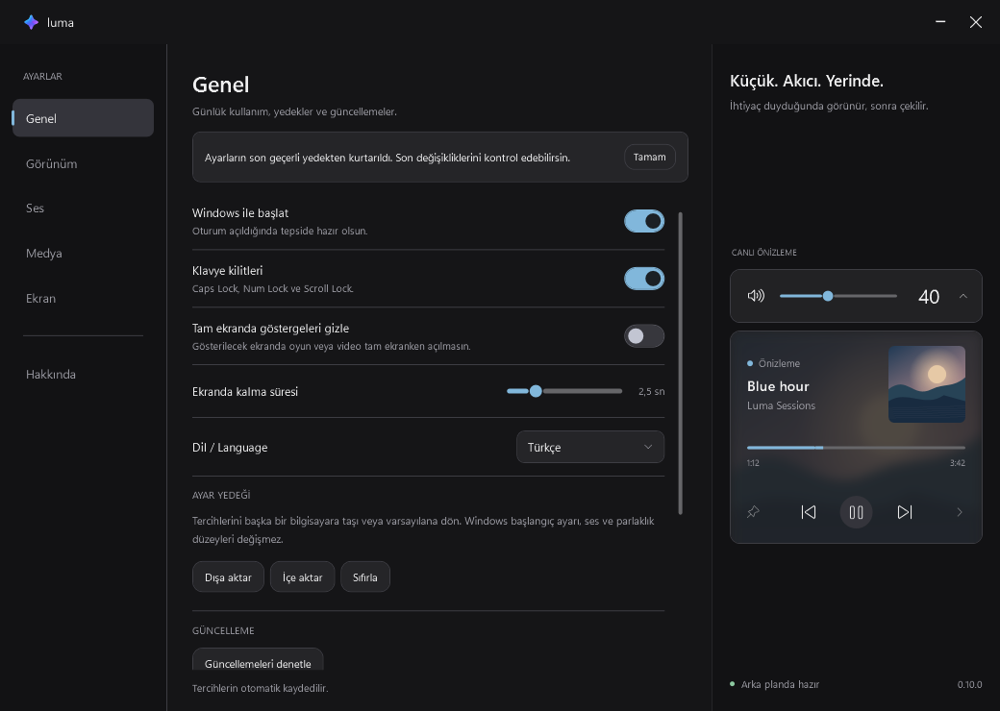

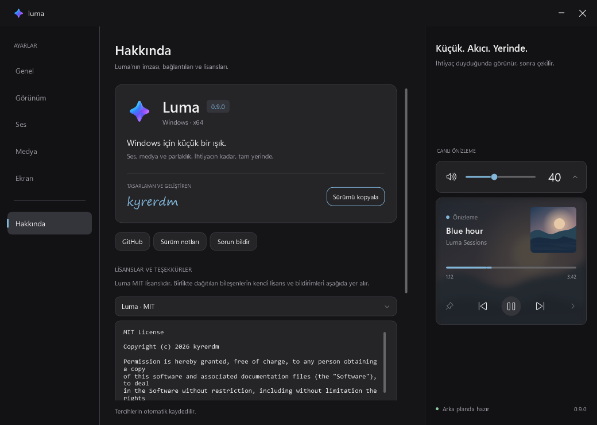

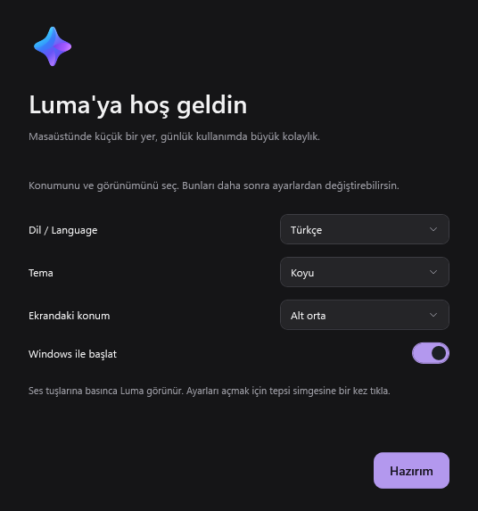

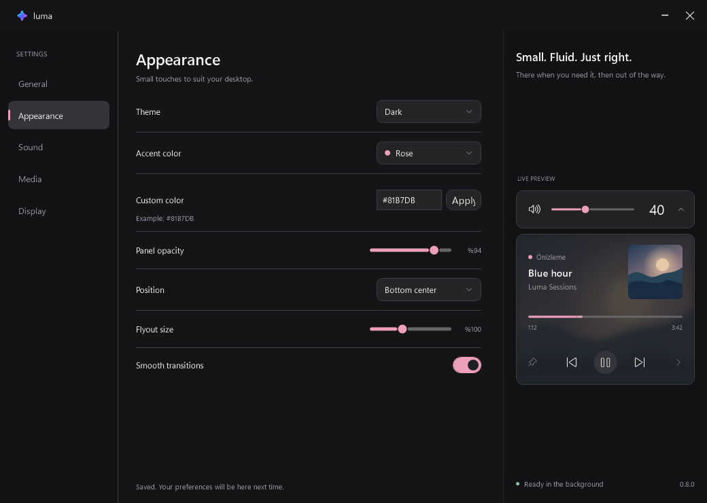

</details>

<details>
<summary>Ses çıkışı, uygulama sesleri ve açık tema</summary>

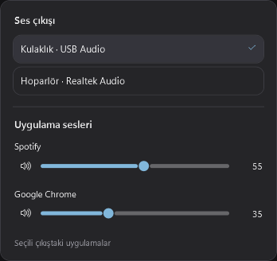
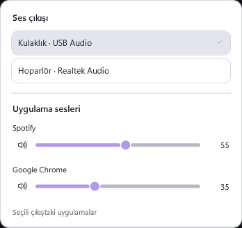
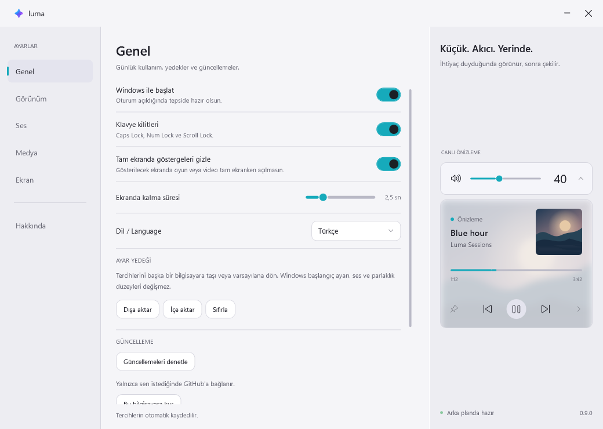

</details>

<details>
<summary>Tepsi menüsü ve renk seçenekleri</summary>

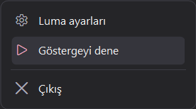
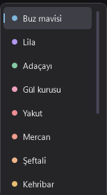

</details>

<details>
<summary>Medya kaynağı seçimi</summary>

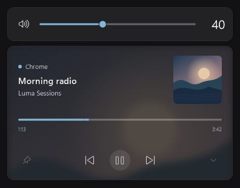
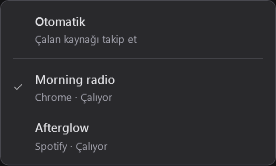

</details>

<details>
<summary>Laptop ekran parlaklığı</summary>

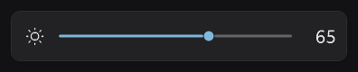
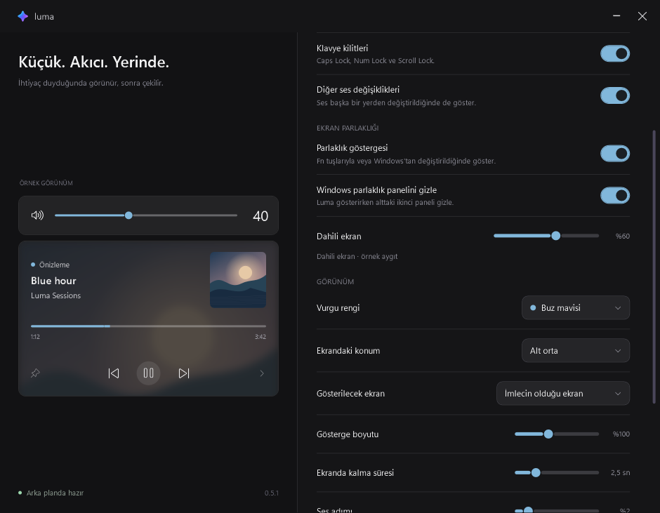

</details>

## Mevcut durum ve sınırlamalar

**1.0.0 ilk kararlı GitHub sürümüdür.** Windows 11 x64 için ses, dahili ekran parlaklığı, klavye göstergeleri, medya kartı, beş dil, kişiselleştirme ve kullanıcı hesabına kurulum sunar. ARM64 paketi ve Microsoft Store yayını henüz yoktur. Paket henüz dijital olarak imzalı değildir. Farklı fiziksel cihazlardaki uyumluluk ve uzun kullanım takibi sürer; bu etiket tüm donanım testlerinin tamamlandığı anlamına gelmez.

Parlaklık kontrolü Windows'un [WmiMonitorBrightness](https://learn.microsoft.com/en-us/windows/win32/wmicoreprov/wmimonitorbrightness) ve [WmiSetBrightness](https://learn.microsoft.com/en-us/windows/win32/wmicoreprov/wmisetbrightness-method-in-class-wmimonitorbrightnessmethods) desteğini kullanan dahili ekranlar içindir. Destek bulunmazsa kaydırıcı pasif görünür. Harici monitörlerde DDC/CI kontrolü isteğe bağlıdır; destekleyen donanım ve uygun bağlantı gerekir. Gösterilecek ekran tercihi panelin konumunu belirler. Fn tuşları ve dahili ekran kaydırıcısı laptop ekranını, DDC/CI kaydırıcıları ise adında belirtilen monitörü kontrol eder. Birden fazla dahili ekran bildirilirse mevcut aktif ekran korunur. Tanınmayan Windows pencere düzenlerinde veya üretici yazılımlarında ek panel görünebilir. Bu bilgisayarın dahili ekranında %100 → %99 → %100 okuma/yazma ve geri yükleme doğrulandı. Farklı laptop modelleri ayrıca denenmelidir.

Medya bilgisi ve düğmeler oynatıcının Windows'a sunduğu özelliklere bağlıdır. Canlı yayınlarda süre veya ileri sarma olmayabilir. Windows medya API'sine erişim ve komut yönlendirmesi kontrol edildi; canlı Spotify/diğer oynatıcılarda uçtan uca kullanım henüz doğrulanmadı.

Kaynak listesi [Windows'un sunduğu medya oturumlarından](https://learn.microsoft.com/en-us/uwp/api/windows.media.control.globalsystemmediatransportcontrolssessionmanager.getsessions) oluşur. Normal Chrome sekmeleri [ortak bir sistem medya oturumu kullanır](https://chromium.googlesource.com/chromium/src/%2B/HEAD/content/browser/media/system_media_controls/); bu durumda iki sekme ayrı ayrı seçilemez. Chrome–Spotify gibi ayrı oturumlar listelenebilir. Her tarayıcı sekmesini bağımsız kontrol etmek ek tarayıcı entegrasyonu gerektirir.

Standart ses tuşları CoreAudio üzerinden işlenir. Bazı üreticilerin Fn yazılımları veya kumandaları farklı yollar kullanabilir; bunlarda Windows'un kendi paneli de görünebilir. Fiziksel Fn tuşları, yönetici olarak çalışan uygulamalar ve farklı DPI değerlerinde çoklu monitör kullanımı ayrıca denenmelidir.

Bir sorunla karşılaşırsan **[Issues](https://github.com/kyrerdm/Luma/issues)** bölümüne Windows sürümünü, Luma sürümünü, kullandığın oynatıcıyı/donanımı ve sorunu tekrar oluşturma adımlarını ekleyebilirsin.

## Gizlilik ve sistem davranışı

Luma telemetri göndermez ve klavye kaydı tutmaz. **Güncellemeleri denetle** düğmesi resmi sürüm bilgisi için GitHub API'ye, **İndir ve güncelle** ise GitHub'ın sürüm dosyası sunucularına bağlanır. Bu işlemler kullanıcı tarafından başlatılır; arka planda kendiliğinden sorgu yoktur. Destek raporu yalnızca seçtiğin dosyaya teknik özet yazar; kullanıcı adı, dosya yolları, aygıt kimlikleri, uygulama adları veya çalan parça içermez ve gönderilmez. Klavye kancası ses ve kilit tuşları için kullanılır. Explorer veya Windows sistem dosyaları değiştirilmez. **Windows ile başlat** açıldığında yalnızca mevcut kullanıcının `HKCU\Software\Microsoft\Windows\CurrentVersion\Run` alanına `LumaFlyouts` girdisi eklenir.

Kurulum seçilirse kullanıcı hesabının `Programs\Luma` klasörüne dosyalar, Başlat menüsü kısayolu ve `HKCU\Software\Microsoft\Windows\CurrentVersion\Uninstall\LumaFlyouts` kaydı eklenir. Masaüstü kısayolu yalnızca seçildiğinde oluşturulur. Otomatik başlatma kendiliğinden açılmaz.

## Kaynak koddan derleme

Son kullanıcıların bu adımlara ihtiyacı yoktur; hazır uygulama **[Releases](https://github.com/kyrerdm/Luma/releases)** bölümündedir.

Geliştirme için **Windows 11**, **Git** ve **.NET SDK x64 10.0.402** gerekir; sürüm `global.json` ile sabittir. Proje WPF, Win32/CoreAudio, Microsoft Windows SDK .NET projeksiyonları ve parlaklık için Microsoft'un System.Management paketini kullanır; harici bir UI kütüphanesi içermez.

```powershell
git clone https://github.com/kyrerdm/Luma.git
cd Luma
.\scripts\build.ps1
.\scripts\verify.ps1
```

Çalışma zamanı dahil taşınabilir paket:

```powershell
.\scripts\build.ps1 -Publish -SelfContained
.\scripts\verify.ps1 -Published
.\scripts\package.ps1
.\scripts\test-package.ps1
```

Çıktı klasörü `artifacts\Luma-1.0.0`, paylaşılacak dosya `artifacts\Luma-1.0.0-win-x64.zip` konumundadır. SHA-256 özeti ZIP'in yanındaki `.sha256` dosyasına yazılır. Hata ayıklama sembolleri dağıtım ZIP'ine eklenmez.

`build.ps1 -Publish`, çalışma zamanını dahil etmeden paket oluşturur; bu çıktı için .NET 10 Desktop Runtime gerekir. Kişisel ayarlardan ayrı bir geliştirme oturumu için:

```powershell
.\artifacts\Luma-1.0.0\Luma.exe --data-dir .\.local
```

Logo vektörü `src\Luma\Assets\Brand.xaml` dosyasındadır. Tepsi ve ayarlar aynı kaynağı kullanır. Vektör değiştiğinde uygulamanın ICO dosyasını ve PNG önizlemelerini PowerShell 7 ile yeniden üret:

```powershell
pwsh -NoProfile -STA -File scripts\New-LumaIcon.ps1
```

### Tepki süresi

Ses aygıtı, medya sorguları ve tuş dinleyicisi arayüzden ayrı yürütülür. Gösterge ilk tuştan önce hazırlanır; yavaş bir aygıt sorgusu panelin görünmesini bekletmez. Bekleyen eski ses yanıtları yeni kullanıcı girişini geri almaz.

Parlaklık WMI sorguları da ayrı yürütülür. Donanım bildirimleri yavaş bir sorgunun bitmesini beklemeden arayüze aktarılır; eski bir okuma yeni bildirimin değerini geri alamaz. Windows panelini gizleme işi, arayüz kuyruğunu beklemeden doğrudan parlaklık etkinliğinden başlatılır. Sürücü bildirim sunmazsa iki saniyelik arka plan okuması kullanılır; destek bulunmayan cihazlarda kontrol aralığı on saniyedir.

Yinelenen Windows parlaklık paneli, parlaklık etkinliğinden sonraki 900 ms boyunca sınırlı bir kontrolle gizlenir. [WinEvent bildirimleri](https://learn.microsoft.com/en-us/windows/win32/api/winuser/nf-winuser-setwineventhook) açılan pencereyi izler; [ShowWindowAsync](https://learn.microsoft.com/en-us/windows/win32/api/winuser/nf-winuser-showwindowasync) görünürlüğünü değiştirir. Pencerenin sınıfı, sistem sürecinin tam dosya yolu, stili, XAML alt penceresi ve DPI'a göre boyutu birlikte doğrulanır. Explorer yeniden başladığında pencere tekrar bulunur. Bildirimler eşzamansız ulaştığı için panel gizlenmeden önce kısa bir an görünebilir; tamamen belirmemesi garanti edilmez. Windows 11 25H2'de 0.5.1 ile fiziksel tuş denemesinde bu kısa belirme gözlendi. Farklı Windows pencere düzenleri tanınmayabilir. Üreticiye ait ayrı göstergeler bu kapsama girmez.

### Doğrulama kapsamı

Yeni ses panelinde gerçek CoreAudio aygıt/oturum okuması ve mevcut aygıtın ses düzeyini değiştirmeden yeniden seçilebilmesi doğrulanır. İkinci bir fiziksel ses aygıtına geçiş, Bluetooth bağlantısı, uyku sonrası kullanım ve farklı laptoplar ayrıca donanım testi gerektirir. Uygulama komutları, eski çıkış/oturumların reddi, kaydırıcı isteklerinin birleştirilmesi, açık panelde otomatik gizlemenin durması ve tema geçişleri izole senaryolarda kontrol edilir. DDC/CI için farklı monitör aralıkları, bağımsız istekler, kapatılınca bekleyen yazıların iptali ve kaynakların bırakılması benzetimlerle doğrulanır; gerçek harici monitörde parlaklık yazımı bu bilgisayarda henüz doğrulanmadı. Kurulum dosyaları ve kaldırma betiği ayrı bir test klasörüne yazılır; testte kişisel kayıt defteri ve kısayollar değiştirilmez. Güncelleme kontrolü ve indirme hata senaryoları sunucu benzetimleriyle, kurulum açılışı ise ayrıca gerçek kurulumla sınanır.

**1.0.0 otomatik doğrulaması** aşağıdaki alanları kapsar; bu sürümün sonuç sayısı [sürüm notlarında](releases/v1.0.0.md) yer alır:

- Ayarların kalıcılığı, son geçerli yedekten kurtarma, bozuk/eksik/aşırı büyük dosyalar ve başarısız/eşzamanlı kayıtlar.
- Salt okunur önizleme sağlayıcıları, gerçek kaydırıcıların kullanılabilirliği, dil değişimi, klavye odağı ve gizli/küçültülmüş önizlemenin yeniden açıldığında yetişmesi.
- Ses/medya/parlaklık servisleri, kaynaklara doğru komut yönlendirme, kapanan aygıtlar, geçici kilit bildirimleri ve yavaş sürücü benzetiminde gösterge tepkisi.
- Ayar içe/dışa aktarımı, kurulum, eksik/değiştirilmiş/iptal edilmiş güncellemeler, güvenilir yönlendirme ve başarısız yeni sürümden geri dönüş.
- Gerçek WPF görünümleri, Hakkında/lisans okuyucu, gömülü bildirimler, köşe/boyut yerleşimi, tepsi menüsü ve renkler.
- Ses panelinde gerçek fare girdileriyle dört köşede aç/kapat, animasyon sırasında hızlı tıklama, panel dışına tıklama ve erişilebilir düğme çağrıları.
- Beş dilde canlı geçiş ve kalıcılık, tüm gömülü çevirilerin anahtar/biçim tutarlılığı, özgün medya adlarının korunması, kurulum/başlangıç ekranları ve en küçük ayar penceresinde metin yerleşimi.

GitHub'daki iş ayrıca `test-localization.ps1` ile çeviri dosyalarını, Windows derlemesini ve `test-package.ps1` ile kurucu, ZIP, rehber/lisans dosyaları ve SHA-256 tutarlılığını kontrol eder. Gerçek masaüstü/ses aygıtı testleri yerel `verify.ps1` ile yapılır. [Çeviri katkısı](LOCALIZATION.md).

Dört köşe yerleşimi, %75 / %100 / %140 ölçekleri, bağlı ekranların listelenmesi ve iki ekranlı bir benzetimde seçim/bağlantı kesilmesi davranışı kontrol edilir. Gerçek monitör takıp çıkarma ve farklı DPI kombinasyonları henüz doğrulanmadı. 1.200 ms bekleyen bir ses aygıtı benzetiminde ilk görüntü hazırlığı 250 ms sınırının altında kalır; bu değer fiziksel Fn tuşunu veya gerçek donanımın uçtan uca gecikmesini ölçmez. Testler normal Windows masaüstü erişimi gerektirir; başsız veya kısıtlı bir ortamda giriş testleri çalışmayabilir. Başlangıç kaydı değiştirilmez. Standart doğrulama gerçek ekran parlaklığını değiştirmez. Desteklenen cihazda bir seviye değiştirip eski değere dönen iki ek donanım kontrolü için verify.ps1 -Published -NativeBrightness kullanılır. Sonuçlar ve WPF'den alınan görseller `artifacts\verification` içine yazılır. Animasyon karelerini GIF'e çevirmek için Pillow bulunan bir Python ile `scripts\render-motion.py` çalıştırılabilir.

## Lisans ve geliştirici

Kararlı sürüm hazırlığının kapsamı, otomatik paket kontrolleri ve performans gözlemi [kararlı sürüm takibinde](KARARLI_SURUM.md) açıklanır. GitHub işi Windows derlemesini ve paket bütünlüğünü kontrol eder; gerçek ses aygıtı veya kullanıcı masaüstü testlerinin yerine geçmez.

Luma **kyrerdm** tarafından tasarlanıp geliştirilir. Özgün Luma kaynak kodu [MIT lisansı](../LICENSE) ile sunulur. Aynı metin kurulumda ve taşınabilir pakette `LICENSE.txt` olarak yer alır. Üçüncü taraf bileşenler kendi lisans ve bildirimlerine tabidir.

**Ayarlar → Hakkında** bölümünde çalışan sürümü ve geliştirici imzasını görebilir, sürüm bilgisini kopyalayabilir ve lisans metinlerini çevrimdışı okuyabilirsin.

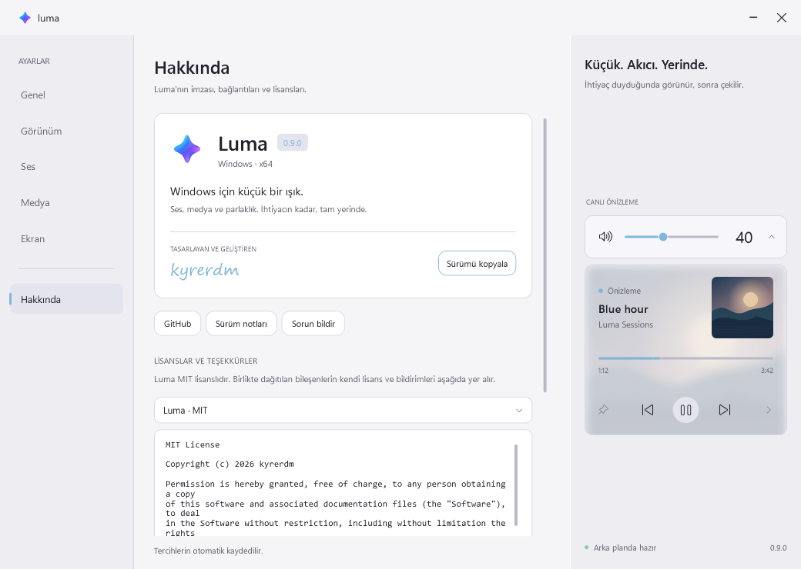

## İlham ve üçüncü taraf bileşenler

Luma, [ModernFlyouts](https://github.com/ModernFlyouts-Community/ModernFlyouts) fikrinden ilham alan bağımsız bir projedir. ModernFlyouts'un kodunu veya görsel varlıklarını içermez; onunla bağlantılı resmi bir devam projesi değildir. Örnek albüm kapağı WPF ile çizilmiştir.

Dağıtım paketindeki .NET, Windows Desktop, Windows SDK ve C#/WinRT bildirimleri uygulamanın yanındaki lisans/bilgi dosyalarında bulunur.

System.Management ve System.CodeDom Microsoft'un MIT lisanslı .NET bileşenleridir; .NET lisansı ve üçüncü taraf bildirimleri pakete dahildir.
